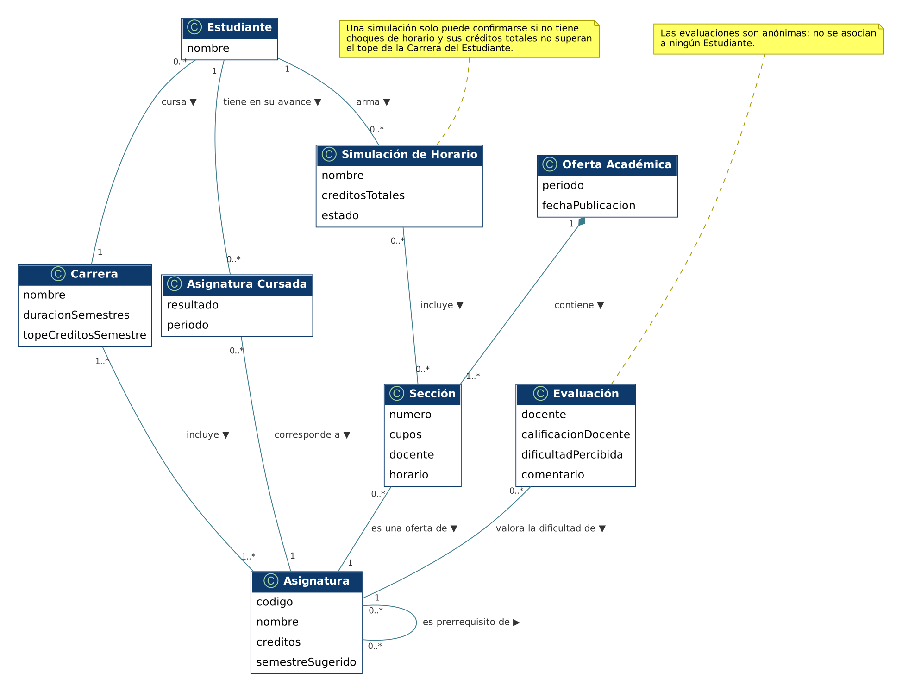

# Modelo de dominio

## Diagrama

Archivo fuente: [`./diagramas/modelo-dominio.puml`](https://github.com/IER-MDI/MDA_IER/blob/main/diagramas/modelo-dominio.puml)

## Descripción de las clases

| Clase | Qué representa en el negocio | Atributos |
|-------|------------------------------|-----------|
| Estudiante | Persona que usa el sistema para planificar su inscripción y su avance curricular. | nombre, rut |
| Carrera | Programa de estudios del estudiante; su malla reúne las asignaturas y fija la duración y el tope de créditos por semestre. | nombre, duracionSemestres, topeCreditosSemestre |
| Asignatura | Ramo de la malla curricular, independiente del período en que se ofrece. | codigo, nombre, creditos, semestreSugerido |
| Asignatura Cursada | Registro del resultado de un estudiante en una asignatura; conforma su avance curricular y el tiempo restante para egresar. | resultado (aprobada, reprobada, en curso), periodo |
| Oferta Académica | Conjunto de secciones que la Administración docente publica en la planilla de un período y que el administrador comunitario sincroniza y publica en el sistema. | periodo, fechaPublicacion |
| Sección | Una oferta concreta de una asignatura dentro de la oferta académica, con su docente, sus cupos y su horario semanal. | numero, cupos, docente, horario |
| Simulación de Horario | Horario simulado: combinación de secciones que un estudiante arma para evaluar su carga y sus choques, y que puede confirmar para su inscripción. | nombre, creditosTotales, estado |
| Evaluación | Opinión anónima sobre un docente y la dificultad percibida de una asignatura; alimenta las métricas de dificultad. | docente, calificacionDocente, dificultadPercibida, comentario |

## Asociaciones

| Asociación | Clases | Multiplicidades | Justificación |
|------------|--------|-----------------|----------------|
| cursa | Estudiante – Carrera | 0..* a 1 | Cada estudiante pertenece a una carrera; una carrera tiene muchos estudiantes. |
| tiene en su malla | Carrera – Asignatura | 1..* a 1..* | La malla de una carrera reúne varias asignaturas, y una asignatura puede formar parte de más de una carrera. |
| tiene en su avance | Estudiante – Asignatura Cursada | 1 a 0..* | El avance curricular de un estudiante se compone de los resultados que ha obtenido. |
| corresponde a | Asignatura Cursada – Asignatura | 0..* a 1 | Cada registro de avance se refiere a una sola asignatura. |
| contiene | Oferta Académica – Sección | 1 a 1..* | Una oferta se compone de al menos una sección y cada sección pertenece a una sola oferta. |
| es una oferta de | Sección – Asignatura | 0..* a 1 | Una asignatura puede ofrecerse en varias secciones; cada sección es de una sola asignatura. |
| arma | Estudiante – Simulación de Horario | 1 a 0..* | Un estudiante puede guardar varias simulaciones para compararlas. |
| incluye | Simulación de Horario – Sección | 0..* a 0..* | Una simulación reúne varias secciones, y una sección puede estar en simulaciones de distintos estudiantes. |
| valora la dificultad de | Evaluación – Asignatura | 0..* a 1 | Cada evaluación indica la dificultad percibida de una asignatura. |
| es prerrequisito de | Asignatura – Asignatura | 0..* a 0..* | Una asignatura puede exigir varias asignaturas previas, y puede ser exigida por varias otras. |

## Decisiones de modelado

- **Roles administrativos:** La Administración docente y el administrador comunitario se modelaron como roles y actores del proceso TO-BE, y no como clases del dominio, porque operan externamente o mediante sincronización sin atributos ni relaciones propias dentro del sistema.
- **Uso de composición y agregación:** Se usó composición entre *Oferta Académica* y *Sección* (una sección no existe fuera de la oferta que la publica y se elimina con ella). No se usó agregación; la relación entre *Simulación de Horario* y *Sección* es una asociación simple, ya que las secciones existen aunque ninguna simulación las incluya.
- **Atributos y datos externos:** Docente, Bloque Horario y Período Académico no se modelaron como clases porque el sistema no almacena información compleja propia sobre ellos, registrándose como simples atributos de texto u horario.
- **Privacidad y anonimato:** La clase *Evaluación* no se asocia con *Estudiante* para garantizar que las valoraciones sean completamente anónimas y no queden vinculadas a ningún identificador personal.
- **Atributos derivados y lógica de negocio:** Datos como la valoración promedio, la dificultad promedio, el tiempo restante para egresar y los créditos totales de la simulación se calculan de forma derivada a partir de otras clases y relaciones del modelo.

# Después de los cambios 

A partir del cambio de requerimientos de la Evaluación 2, el modelo de dominio se amplía para representar la planificación académica del estudiante con asignaturas recomendadas, tentativas y confirmadas.

### Nuevos elementos incorporados

| Elemento nuevo | Descripción |
|---|---|
| Recomendación de Asignatura | Representa una asignatura sugerida al estudiante para optimizar su avance curricular. |
| estado | Indica el estado de la recomendación, pudiendo ser `tentativo` o `confirmada`. |
| fechaPropuesta | Fecha en la que la asignatura fue sugerida o agregada al planificador. |
| fechaConfirmacion | Fecha en la que el estudiante confirma la asignatura desde el planificador. |

### Nuevas asociaciones

| Asociación | Clases | Multiplicidades | Justificación |
|---|---|---|---|
| contiene propuesta | Simulación de Horario – Recomendación de Asignatura | 1 a 0..* | Una simulación puede contener varias recomendaciones de asignaturas. |
| recomienda | Recomendación de Asignatura – Asignatura | 0..* a 1 | Cada recomendación corresponde a una asignatura específica. Una asignatura puede estar presente en distintas recomendaciones. |

### Cambios realizados en el modelo

- Se **agrega la clase `Recomendación de Asignatura`** al modelo de dominio.
- Se incorpora el atributo **`estado`** para distinguir si una asignatura está en condición **tentativa** o **confirmada**.
- Se relaciona la nueva clase con **`Simulación de Horario`**, ya que las recomendaciones aparecen dentro del planificador.
- Se relaciona la nueva clase con **`Asignatura`**, porque cada recomendación corresponde a un ramo concreto de la malla.
- Se mantiene separada de **`Asignatura Cursada`**, ya que una asignatura confirmada en el planificador **no significa** que haya sido aprobada o cursada.
- Este cambio da soporte a los requerimientos de la **HU-02** y la **HU-05**, permitiendo mostrar asignaturas sugeridas, agregarlas en estado tentativo y confirmarlas desde el planificador.

### Resumen del impacto

Antes del cambio, el modelo solo representaba la simulación de horario y el avance curricular del estudiante.

Después del cambio, el modelo también representa el flujo de planificación académica del estudiante, permitiendo:
- recomendar asignaturas,
- agregarlas en estado tentativo,
- confirmarlas desde el planificador,
- y mantener separada la planificación del historial académico real.
