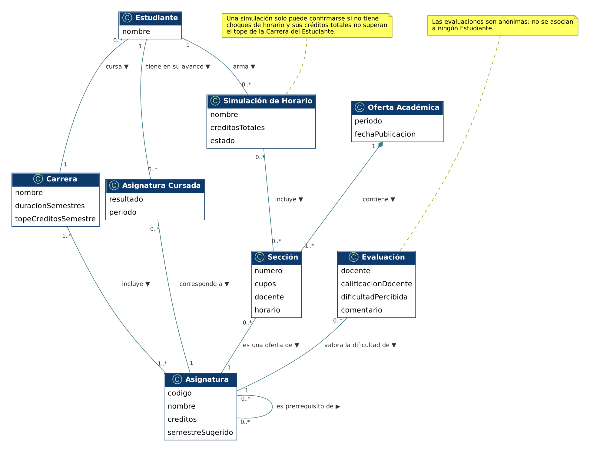

# Modelo de dominio

## Diagrama

Archivo fuente: [`./diagramas/modelo-dominio.puml`](./diagramas/modelo-dominio.puml)

## Descripción de las clases

| Clase | Qué representa en el negocio | Atributos |
|-------|------------------------------|-----------|
| Estudiante | Persona que usa el sistema para planificar su inscripción y su avance curricular.[cite: 2] | nombre, rut[cite: 2] |
| Carrera | Programa de estudios del estudiante; su malla reúne las asignaturas y fija la duración y el tope de créditos por semestre.[cite: 2] | nombre, duracionSemestres, topeCreditosSemestre[cite: 2] |
| Asignatura | Ramo de la malla curricular, independiente del período en que se ofrece.[cite: 2] | codigo, nombre, creditos, semestreSugerido[cite: 2] |
| Asignatura Cursada | Registro del resultado de un estudiante en una asignatura; conforma su avance curricular y el tiempo restante para egresar.[cite: 2] | resultado (aprobada, reprobada, en curso), periodo[cite: 2] |
| Oferta Académica | Conjunto de secciones que la Administración docente publica en la planilla de un período y que el administrador comunitario sincroniza y publica en el sistema.[cite: 2] | periodo, fechaPublicacion[cite: 2] |
| Sección | Una oferta concreta de una asignatura dentro de la oferta académica, con su docente, sus cupos y su horario semanal.[cite: 2] | numero, cupos, docente, horario[cite: 2] |
| Simulación de Horario | Horario simulado: combinación de secciones que un estudiante arma para evaluar su carga y sus choques, y que puede confirmar para su inscripción.[cite: 2] | nombre, creditosTotales, estado[cite: 2] |
| Evaluación | Opinión anónima sobre un docente y la dificultad percibida de una asignatura; alimenta las métricas de dificultad.[cite: 2] | docente, calificacionDocente, dificultadPercibida, comentario[cite: 2] |

## Asociaciones

| Asociación | Clases | Multiplicidades | Justificación |
|------------|--------|-----------------|----------------|
| cursa | Estudiante – Carrera[cite: 2] | 0..* a 1[cite: 2] | Cada estudiante pertenece a una carrera; una carrera tiene muchos estudiantes.[cite: 2] |
| tiene en su malla | Carrera – Asignatura[cite: 2] | 1..* a 1..*[cite: 2] | La malla de una carrera reúne varias asignaturas, y una asignatura puede formar parte de más de una carrera.[cite: 2] |
| tiene en su avance | Estudiante – Asignatura Cursada[cite: 2] | 1 a 0..*[cite: 2] | El avance curricular de un estudiante se compone de los resultados que ha obtenido.[cite: 2] |
| corresponde a | Asignatura Cursada – Asignatura[cite: 2] | 0..* a 1[cite: 2] | Cada registro de avance se refiere a una sola asignatura.[cite: 2] |
| contiene | Oferta Académica – Sección[cite: 2] | 1 a 1..*[cite: 2] | Una oferta se compone de al menos una sección y cada sección pertenece a una sola oferta.[cite: 2] |
| es una oferta de | Sección – Asignatura[cite: 2] | 0..* a 1[cite: 2] | Una asignatura puede ofrecerse en varias secciones; cada sección es de una sola asignatura.[cite: 2] |
| arma | Estudiante – Simulación de Horario[cite: 2] | 1 a 0..*[cite: 2] | Un estudiante puede guardar varias simulaciones para compararlas.[cite: 2] |
| incluye | Simulación de Horario – Sección[cite: 2] | 0..* a 0..*[cite: 2] | Una simulación reúne varias secciones, y una sección puede estar en simulaciones de distintos estudiantes.[cite: 2] |
| valora la dificultad de | Evaluación – Asignatura[cite: 2] | 0..* a 1[cite: 2] | Cada evaluación indica la dificultad percibida de una asignatura.[cite: 2] |
| es prerrequisito de | Asignatura – Asignatura[cite: 2] | 0..* a 0..*[cite: 2] | Una asignatura puede exigir varias asignaturas previas, y puede ser exigida por varias otras.[cite: 2] |

## Decisiones de modelado

- **Roles administrativos:** La Administración docente y el administrador comunitario se modelaron como roles y actores del proceso TO-BE, y no como clases del dominio, porque operan externamente o mediante sincronización sin atributos ni relaciones propias dentro del sistema[cite: 2].
- **Uso de composición y agregación:** Se usó composición entre *Oferta Académica* y *Sección* (una sección no existe fuera de la oferta que la publica y se elimina con ella). No se usó agregación; la relación entre *Simulación de Horario* y *Sección* es una asociación simple, ya que las secciones existen aunque ninguna simulación las incluya[cite: 2].
- **Atributos y datos externos:** Docente, Bloque Horario y Período Académico no se modelaron como clases porque el sistema no almacena información compleja propia sobre ellos, registrándose como simples atributos de texto u horario[cite: 2].
- **Privacidad y anonimato:** La clase *Evaluación* no se asocia con *Estudiante* para garantizar que las valoraciones sean completamente anónimas y no queden vinculadas a ningún identificador personal[cite: 2].
- **Atributos derivados y lógica de negocio:** Datos como la valoración promedio, la dificultad promedio, el tiempo restante para egresar y los créditos totales de la simulación se calculan de forma derivada a partir de otras clases y relaciones del modelo[cite: 2].
