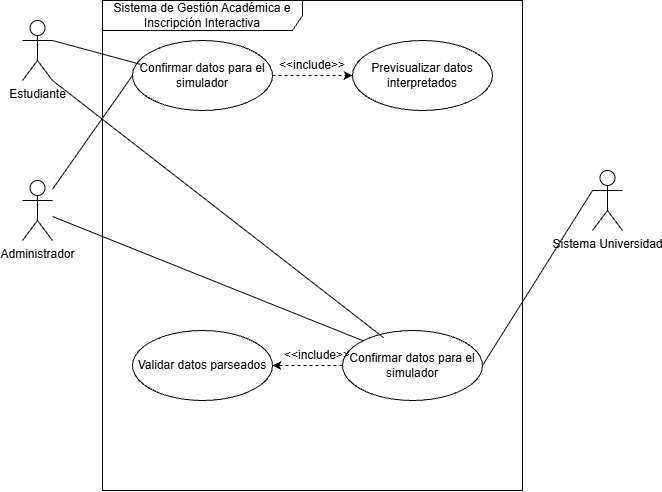
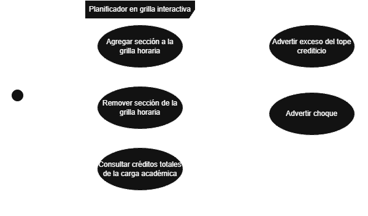

# Casos de uso
## Historia de origen:
HU-01: Carga y Traducción de Oferta Académica en Excel
## Actores
| Actor | Tipo (humano / sistema externo) | Descripción |
|-------|----------------------------------|-------------|
| Estudiante  | Humano | Sube la planilla y confirma datos para el simulador |
|Administrador| Humano | Mismo rol que estudiante|
|Sistema de la Universidad| Sistema externo | Entrega la fuente con la oferta académica|
 
## Diagrama de casos de uso

 
Archivo fuente: [`./diagramas/casos-de-uso.drawio`](./diagramas/casos-de-uso.drawio)
 
## Casos de uso y su origen
| ID | Caso de uso (objetivo del actor) | Actor principal | Historia de origen |
|----|-----------------------------------|-----------------|---------------------|
| CU-01 | Cargar planilla | Estudiante, Admin. comunitario, Sistema Universidad | [HU-01](./04-historias-usuario.md#hu-01) |
| CU-02 | Validar datos parseados | Estudiante, Admin. comunitario, Sistema Universidad  | [HU-01](./04-historias-usuario.md#hu-01) |
| CU-03 | Previsualizar datos | Estudiante y administrador | [HU-01](./04-historias-usuario.md#hu-01) |
| CU-04 | Confirmar datos | Estudiante y administrador | [HU-01](./04-historias-usuario.md#hu-01) |
| CU-05 | Simular horario semestral | Estudiante | [HU-02](./04-historias-usuario.md#hu-02) |

# Caso de uso 2
## Historia de origen:
HU-02: Planificador en Grilla Interactiva
## Actores
| Actor | Tipo (humano / sistema externo) | Descripción |
|-------|----------------------------------|-------------|
| Estudiante  | Humano |Simula combinaciones de horario en la grilla y revisa su carga académica |

 
## Diagrama de casos de uso

 
Archivo fuente: [`./diagramas/casos-de-uso.drawio`](./diagramas/CU-02.drawio)
 
## Casos de uso y su origen
| ID | Caso de uso (objetivo del actor) | Actor principal | Historia de origen |
|----|-----------------------------------|-----------------|---------------------|
| CU-06 | Agregar sección a grilla horaria | Estudiante | [HU-01](./04-historias-usuario.md#hu-02) |
| CU-07 | Remover sección de la grilla horaria | Estudiante | [HU-01](./04-historias-usuario.md#hu-02) |
| CU-08 | Consultar créditos totales de la carga académica | Estudiante | [HU-01](./04-historias-usuario.md#hu-02) |
| CU-09 | Advertir choque de horario | - | [HU-01](./04-historias-usuario.md#hu-02) |
| CU-10 | Advertir exceso del tope crediticio | -| [HU-02](./04-historias-usuario.md#hu-02) |
