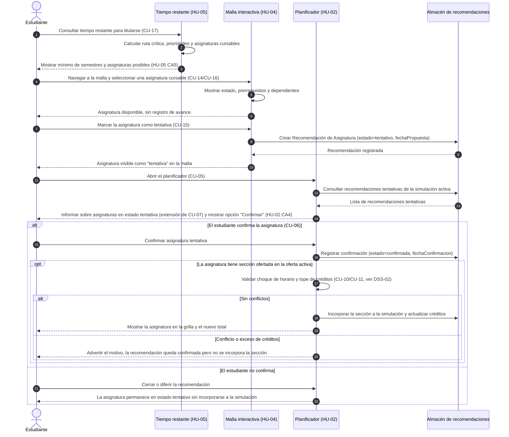

[10-diagramas-secuencia.md](https://github.com/user-attachments/files/35443203/10-diagramas-secuencia.md)
# Diagramas de secuencia de sistema
 
 
## DSS-01 — Carga y validación de oferta académica
- Casos de uso: [CU-01](./09-casos-uso.md) … [CU-04](./09-casos-uso.md)
- Historia: [HU-01](./04-historias-usuario.md#hu-01)
- Sistemas externos que participan: Sistema de la Universidad (antecedente; publica la planilla, sin mensajes en el DSS)

 
[Diagrama DSS-01 (fuente Mermaid)](./diagramas/dss_01.md)
 
Variantes representadas:

- **alt — Formato de archivo:** verifica si el archivo Excel o CSV es admitido. Si no lo es, informa un error.
- **opt — Corrección del mapeo:** permite que el usuario modifique la correspondencia entre las columnas de la planilla y los campos del sistema.
- **loop — Validación de datos:** repite la validación mientras existan inconsistencias que deban corregirse.
- **alt — Confirmación de oferta:** publica los datos cuando son válidos y el usuario confirma; de lo contrario, finaliza sin publicarlos.

 
## DSS-02 — Simulación de horario académico (HU-02)
- Caso de uso: [CU-05](./09-casos-uso.md)
- Historia: [HU-02](./04-historias-usuario.md#hu-02)
- Sistemas externos que participan: Ninguno durante la simulación

- **alt:** conflictos de horario, exceso de créditos y selección válida.
- **opt:** eliminar una sección.
- **loop:** modificar horario repetidamente.

## DSS-03 — Registro y confirmación de asignatura en estado tentativo (Evaluación 2)
- Casos de uso: [CU-06](./09-casos-uso.md) y [CU-15](./09-casos-uso.md); extensión «Informar sobre asignaturas en estado tentativa» de CU-07; relacionado con CU-14, CU-16 y CU-17
- Historias: [HU-05 CA5](./04-historias-usuario.md#hu-05) (asignaturas posibles para agilizar el avance), [HU-04](./04-historias-usuario.md#hu-04) (marca como tentativa en la malla) y [HU-02 CA4](./04-historias-usuario.md#hu-02) (confirmación desde el planificador)
- Diagrama de estado relacionado: [EST-02 — Recomendación de Asignatura](./11-diagramas-estado.md#est-02--ciclo-de-vida-de-recomendación-de-asignatura-avance-académico), con transición `tentativo` → `confirmada`
- Sistemas externos que participan: Ninguno

[Diagrama DSS-03 (fuente Mermaid y notas)](./diagramas/dss_03.md) · [Imagen PNG](./diagramas/dss_03.png)

Variantes representadas:

- **alt — Confirmación del estudiante:** al confirmar, la recomendación pasa a `confirmada` y registra `fechaConfirmacion`; si no confirma, permanece `tentativo` sin incorporarse a la simulación.
- **opt — Sección ofertada:** la incorporación a la grilla solo se intenta si la asignatura tiene sección en la oferta activa (una asignatura de la malla puede no tenerla).
- **alt — Validación de carga:** se reutilizan las reglas de choque de horario y tope de créditos descritas en DSS-02 (CU-10/CU-11); ante un conflicto se informa el motivo y no se agrega la sección.

- **loop:** modificar horario repetidamente.
