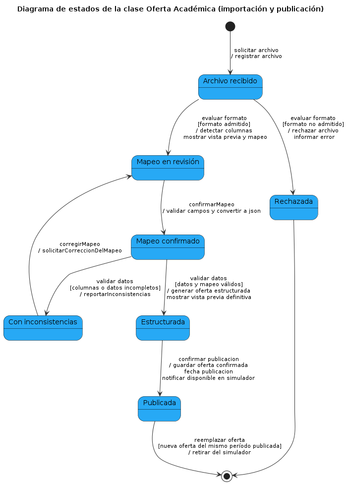

# Diagramas de estado
 
## EST-01 — Ciclo de vida de [Clase]
- Clase del dominio: [Clase](./08-modelo-dominio.md)
- Diagramas de secuencia relacionados: [DSS-01](./10-diagramas-secuencia.md)
 

 
Archivo fuente: [`./diagramas/est-01.puml`](./diagramas/est-01.puml)
 
### Tabla de transiciones
| Estado origen | Evento | Guarda | Acción | Estado destino |
|---------------|--------|--------|--------|----------------|
| Inicio | solicitar archivo | -| registrar archivo | Archivo recibido |
| Archivo recibido | evaluar formato | formato admitido | detectar columnas / mostrar vista previa y mapeo|Mapeo en revisión|
| Archivo recibido | evaluar formato | formato no admitido | rechazar archivo / informar error| Rechazada|
| Mapeo en revisión | confirmar mapeo | — | validar campos y convertir a json | Mapeo confirmado|
|Mapeo confirmado | validar datos | datos y mapeo válidos | generar oferta estructurada / mostrar bista previa definitiva| Estructurada |
|Mapeo confirmado | validar datos | columnas o datos incompletos | reportar inconsistencias| Con inconsistencias|
|Con inconsistencias | corregir mapeo | — | solicitar correccion del mapeo| Mapeo en revisión|
|Estructurada | confirmar publicacion | almacén confirma el registro | guardar oferta confirmada / fecha publicacion / notificar disponible en simulador| Publicada |
|Publicada | reemplazar oferta | nueva oferta del mismo período publicada | retirar del simulador| fin |
|Rechazada | — | — | — | fin |
 
## EST-02 — Ciclo de vida de [Clase]
[Misma estructura. Mínimo 2 diagramas.]
