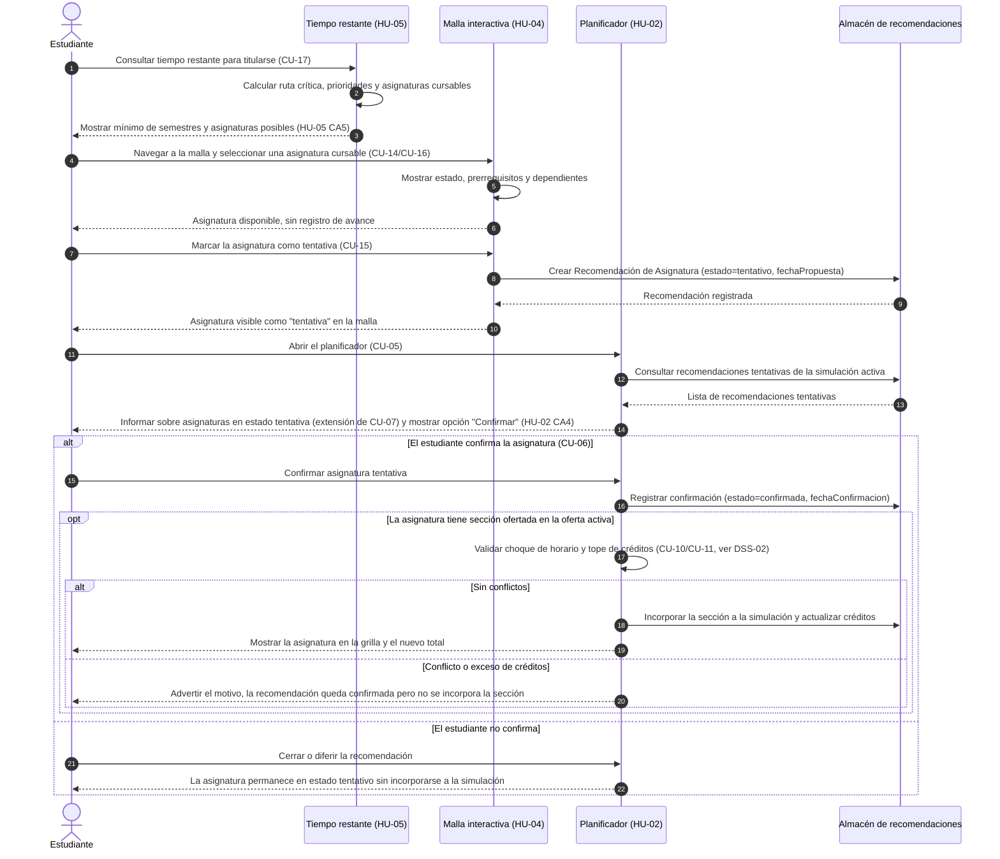

# DSS-03 — Registro y confirmación de asignatura en estado tentativo

Cambio de Evaluación 2 (`EVALUACION2.md`): el sistema sugiere asignaturas para agilizar el avance (HU-05), el estudiante marca una como **tentativa** desde la malla (HU-04/CU-15), la ve en el planificador y la **confirma** desde ahí (HU-02/CU-06). La recomendación se modela como *Recomendación de Asignatura* con estado `tentativo` → `confirmada`, asociada a la *Simulación de Horario* activa (`08-modelo-dominio.md`). Su ciclo de vida se detalla en [EST-02](./est-02.puml).

Imagen generada: [dss_03.png](./dss_03.png)

## Participantes

| Participante | Rol en el flujo |
|--------------|-----------------|
| Estudiante | Actor principal: consulta el avance, marca la asignatura como tentativa y la confirma desde el planificador. |
| Tiempo restante (HU-05) | Calcula la ruta crítica y muestra las asignaturas posibles que agilizan el avance (CA5). |
| Malla interactiva (HU-04) | Muestra estados, prerrequisitos y dependientes; permite marcar la asignatura como tentativa (CU-15). |
| Planificador (HU-02) | Informa sobre asignaturas tentativas (extensión de CU-07) y permite confirmarlas (CU-06). |
| Almacén de recomendaciones | Persiste la *Recomendación de Asignatura* con `estado`, `fechaPropuesta` y `fechaConfirmacion`, asociada a la simulación activa. |

## Variantes representadas

- **alt — Confirmación del estudiante:** si confirma, la recomendación pasa a `confirmada` y registra `fechaConfirmacion`; si no, permanece `tentativo` sin incorporarse a la simulación.
- **opt — Sección ofertada:** la incorporación a la grilla solo se intenta si la asignatura tiene sección en la oferta activa (una asignatura de la malla puede no tenerla).
- **alt — Validación de carga:** se reutilizan las reglas de choque de horario y tope de créditos de DSS-02 (CU-10/CU-11); ante un conflicto se informa el motivo y no se agrega la sección.
